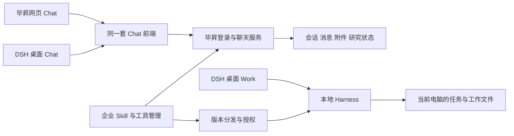

# BISHENG 与 DSH 的 Chat / Work 整合方案

2026-10-16 · 企业版共享侧栏调整稿

本文依据用户最新确认的企业版仓库和产品边界整理。桌面开发基于 `dataelement/bisheng-work` 的 `V1.2.0`，在独立功能分支实现。该仓库由企业版独立维护，并定期合入桌面功能；源码及依赖以该仓库为准。实际交付状态见文末。

## 1. 本期先统一什么

短期保留毕昇现有 Chat 能力及调用规则，统一视觉、基础交互和桌面端入口。DSH 增加 Chat，访问毕昇的同一套聊天服务和会话数据；DSH 原有本地任务继续归入 Work。

毕昇现有任务模式在产品入口上归入 Chat，用户以“深度研究”使用。短期继续沿用现有研究执行链路。后续在毕昇部署同类 Harness 时，再迁移研究执行内核。

企业后台统一管理 Skill 和工具是独立的建设项，可以与 Chat 接入分批交付。统一管理需要管理目录、分发和运行接入分别成立，单独增加一个后台列表只完成目录部分。

| 对象 | 执行位置 | 数据归属 | 两端关系 |
| --- | --- | --- | --- |
| Chat 普通聊天 | 毕昇服务端 | 毕昇账号与租户下的会话 | 网页和桌面访问同一份记录 |
| Chat 深度研究 | 短期沿用毕昇现有研究链路 | 研究过程和产物关联原 Chat 会话 | 网页和桌面共同查看、继续操作 |
| Work 本地任务 | 用户电脑上的 DSH Harness | 当前电脑的任务、工作目录和文件 | 保持本地任务入口 |
| Skill / 工具目录 | 企业后台管理元数据、版本和授权 | 按来源、所有者、可用范围管理 | Chat 和 Work 按各自运行能力接入 |

## 2. 功能差异先保留，逐项定义交互

现在毕昇输入框有知识空间、工具、深度研究、模型等入口。DSH 的输入框通过通用入口和扩展位置组织功能，Work 还涉及本地执行权限、计划及工作目录。两者采用统一视觉后，仍会存在业务入口差异。

第一期以现有功能回归通过为前提。可以调整尺寸、排列、菜单层级和选中态；涉及默认范围、自动调用或执行方式的变化进入后续需求。

| 能力 | 短期规则 | 后续可评估的简化 |
| --- | --- | --- |
| 文本输入、发送、停止 | 统一尺寸、快捷键提示、加载和失败反馈；保持各自执行语义 | 在具备服务端支持后研究排队、插入补充指令 |
| 文件上传 | 保留类型、数量、大小、解析及权限限制；统一附件卡片 | 将成熟的文件操作汇入统一菜单 |
| 知识空间 / 组织知识库 | 保留显式选择、选中范围、取消和引用来源 | 收进“＋”，选中后显示引用标签 |
| 工具选择 | 保留现有手选及调用范围 | 明确企业授权、默认启用和自动选择规则后，再调整常驻入口 |
| 模型选择 | 保留现有模型可用范围、选中和记忆规则 | 统一位置及菜单样式 |
| 深度研究 | 作为 Chat 内的能力保留；普通轮次和研究轮次沿现有规则执行 | 优化启用入口，或后续迁移执行内核 |
| Skill 选择 | 保留当前适用模式和选择规则 | 统一目录后再扩展至其他模式和自动选用 |
| 文件预览 | 统一右侧布局、关闭、全屏、下载及切换 | 单独建设服务端 Office 转换和保真渲染 |
| Work 的目录、权限、计划 | 保持在本地 Work 中 | 依赖具体工作模式继续迭代 |

目前源码中，毕昇发送请求携带用户选择的工具列表；Skill 在研究轮次中传入。将工具选择改成自动调用、让所有 Chat 使用 Skill，都属于功能改造。第一期继续使用现有规则。

入口存在重复时，可以合并为一个清楚的入口，同时完整保留原操作能力。具体入口位置先形成对照稿，再按稿实施。上一轮提出的“默认只显示＋、模型和发送”保留为后续候选方案。

## 3. 桌面端如何接入 Chat

企业客户端保留同一套 DSH 原生侧栏，同时展示云端聊天和本地工作区记录。点击记录按来源切换右侧；切换模式时左侧保持，Work 数据继续存本机。企业客户端提供“聊天 / 工作”两个入口，使用参考图中的分段按钮，位于主内容顶部、输入区上方。聊天加载与企业客户端视觉一致的毕昇 Chat 网页；工作沿用 `bisheng-work/V1.2.0` 的本地任务界面和功能。空白页、消息区、输入框、侧栏和文件预览按同一套尺度与交互规范验收。聊天／工作选择器仅在新建会话页显示。进入已有云端聊天、本地任务或插件等全局面板后收起整条选择栏，内容区填满可用高度。侧栏历史按来源打开对应模式；新建页选择模式时进入该模式的空白会话，已有会话与任务继续保留。

侧栏按“项目＋最近”组织。项目内的本地会话只在所属项目出现；未分组的本地 Work 与云端 Chat 在最近混排，来源使用电脑和对话图标区分。点击记录打开对应模式，顶部模式切换保持侧栏。当前默认工作区也是实际项目；项目归属沿用 Harness 的权威数据。

最近以置顶和更新时间排序，项目菜单及原有手动排序继续由 Harness 提供。单列表展示所有记录；标题搜索同时匹配已加载云端记录和原生本地搜索结果。云端记录分页加载，搜索范围随加载扩展。Chat 数据保持在毕昇，Work 会话与项目数据保存在本机。



桌面 Chat 可以采用受控的网页容器。前端提供嵌入布局，收起宿主已提供的导航和账号入口，保留知识空间等业务入口；网页仍保留完整导航。两端共用聊天组件和业务逻辑，通过布局参数适配外壳。

用户在客户端企业入口完成登录后，Chat 自动使用同一企业平台、账号、租户和授权范围。平台地址由企业连接配置提供。宿主通过服务端认可的会话交接机制建立网页登录态，凭据由宿主安全管理。企业身份失效时回到统一企业登录入口；退出或切换账号、租户时，清理对应网页会话、缓存和订阅。企业模型凭据与网页会话的具体转换方式，以 `bisheng-work/V1.2.0` 和目标测试环境的源码核查结果确定。

桌面桥接只承担必要的上传选择、下载保存、预览和链接打开。远程 Chat 页面采用隔离环境，通过窄接口调用受控宿主能力；本地 Work 沿原有策略与审计执行。平台服务凭据由服务端或受控宿主管理。

研发在实施前确认网页容器形式、登录交接、Cookie / 存储隔离、上传下载桥接和升级兼容。技术选择以现有代码可复用程度为准。

## 4. 会话和附件如何打通

毕昇服务端作为 Chat 的权威数据源。网页和桌面使用同一账号、同一租户和同一会话标识访问记录。客户端缓存用于展示和恢复，服务端确认决定消息与操作的最终状态。

| 场景 | 目标行为与验收 |
| --- | --- |
| 新建、发送 | 任一端创建后，另一端可以发现并打开；同一发送操作重试只产生一条消息 |
| 历史与研究过程 | 两端展示同一顺序的消息、研究状态、错误和产物；重开页面可恢复服务端已保存的内容 |
| 生成中换端 | 另一端可以看到运行状态；服务端具备恢复数据时继续展示过程，否则先加载已保存进度，再刷新最终结果 |
| 两端同时输入 | 第一版建议同一会话串行执行；另一端明确显示运行状态，服务端统一约束并发行为 |
| 重命名、删除 | 服务端确认后同步更新；旧请求及迟到事件遵循删除结果 |
| 断网与重连 | 明确显示断线；恢复后按服务端记录补齐。离线草稿保存在本端，自动离线发送队列后续单列 |
| 账号或租户切换 | 新身份只读取自身范围，会话列表、附件访问和缓存分别隔离 |
| Work 本地任务 | 任务留在当前电脑；若未来需要把产物带入 Chat，用户通过明确的上传动作完成 |

消息恢复和去重所需的服务端事件、消息标识、取消与并发控制，先检查现有接口支持情况。已有能力直接复用，缺口按场景补齐，避免第一期同时重写聊天协议。

Chat 上传的文件和研究产物由毕昇统一保存、授权和提供访问地址。两端展示同一文件；桌面下载是保存一份本地副本。文件预览区统一外观及操作，渲染能力按当前格式逐项确认。

第一期保留毕昇现有 PDF / DOCX / XLSX 等处理链路，当前可下载格式继续提供下载。DSH 的本地 Office 引擎若需要用于网页端，应另行评估服务端转换部署、字体、性能、许可和版式验收。仅调整预览外壳无法自动获得同一渲染结果。

## 5. Skill 和工具统一管理的实现逻辑

建议采用统一目录、分别发布到运行环境的方式。后台面向同一个企业提供管理入口，Chat 和 Work 各自报告支持的能力和生效版本。

### Skill 来源与适用范围

| 来源 | 谁维护 | 谁使用 | 建议规则 |
| --- | --- | --- | --- |
| 官方内置 | 产品提供者 | 按企业策略开放 | 内置包保留官方来源与版本，企业可以配置启用范围 |
| 企业上传 | 企业管理员或获授权的发布者 | 企业指定成员 | 版本、启用状态和适用运行环境统一发布 |
| 个人上传 | 个人用户 | 默认本人 | 企业可以控制企业环境内的上传和使用范围；企业共享作为单独发布动作 |

来源回答“谁维护”，适用环境回答“在哪里能运行”。同一个 Skill 可以支持 Chat、Work 或两者；需要本地文件、终端或桌面操作的 Skill，在相应能力可用的 Work 环境运行。面向 Chat 发布时，必须具备等价的服务端依赖。

目录最少记录稳定标识、来源、所有者、版本、适用环境、依赖工具、发布范围及启用状态。一次执行记录实际使用的版本，便于定位问题。

DSH 现有内置 Skill 的接入分三步：先盘点现有包和稳定标识；再导入企业目录，标记来源与适用环境；最后让企业模式下的 Desktop 按企业配置安装、启用并回报版本。新任务采用有效配置，运行中任务固定开始时的版本；紧急停用通过明确的取消或拦截规则执行。

短期可先完成官方与企业 Skill 的目录、启停及版本分发。个人上传若已有能力则保留；新增个人共享、审核和跨企业流转按后续需求安排。企业治理的范围限定在企业身份及企业提供的资源，个人本地空间另按产品模式定义。

### 工具与 Skill 的区别

工具也进入统一目录，但保留独立对象。工具是可执行能力，Skill 是调用能力的说明和流程，一个 Skill 可以依赖多个工具。

平台工具由服务端执行；本地工具由 Desktop 宿主执行；连接器凭据由对应执行方安全保管。后台统一管理工具名称、来源、授权范围、配置状态和适用环境。用户在 Chat 输入框中的手选行为先保留。

管理项被保存后，要分别展示发布状态与设备生效状态。桌面离线时显示最近同步状态，重连后拉取企业配置；新建企业任务时如何处理配置过期，应由企业策略明确规定。单次目录同步成功与真实调用成功分别验收。

## 6. 实施顺序和每批交付

| 批次 | 主要工作 | 交付及验收条件 |
| --- | --- | --- |
| 0：功能与交互对照 | 按入口、选择规则、运行行为和异常处理盘点毕昇与 DSH；标明保留、样式统一、后续改功能 | 形成双方认可的对照清单及页面稿；当前阶段 |
| 1：Chat 视觉与桌面接入 | 沿用毕昇功能，收敛布局差异；复用企业登录，完成嵌入布局和必要文件桥接 | 企业登录后桌面自动进入 Chat；网页和桌面可聊同一会话、打开附件；原有功能回归通过 |
| 2：跨端状态补齐 | 根据现有接口补足生成中恢复、重连、去重、并发、删除和账号切换 | 双端用真实服务逐项跑通，普通账号和租户隔离通过 |
| 3：企业管理接入 | Skill / 工具统一目录，官方包登记，企业发布、授权与 Desktop 分发 | 后台变更能在目标 Chat / Work 生效，版本可查；分别完成真实调用验收 |
| 后续：能力与体验统一 | 决定工具自动调用、Skill 跨模式、Office 渲染以及服务端 Harness 迁移 | 每项单独评估工作量与依赖，按对应真实场景验收 |

批次 1 和 2 共同构成“会话打通”的完整交付。企业管理可独立安排研发，首期接入准备需预留统一身份及目录标识。平台 Work 执行仍按用户已确定的后续范围安排。

当前先确定阶段范围，再由研发按现有服务端能力与 Desktop 身份实现估时。本文没有以界面工作量替代登录、同步、分发和渲染的工作量。

## 7. 同事接手开发

目标仓库为 `dataelement/bisheng-work`，目标分支为 `V1.2.0`。2026-10-16 通过 GitHub API 核对远端基线为 `dde330fb7f2ab61ef5baab214a959f3fb437c66e`，应用包版本为 `1.0.1`，Harness 为 `0.2.0-rc.2`。三种版本各自记录。

### 本地启动

```sh
git clone --branch V1.2.0 https://github.com/dataelement/bisheng-work.git
cd bisheng-work
npm ci
npm run dev
```

`npm ci` 的 postinstall 会重放 `patches/` 中的 Harness 扩展。开发使用 Node 版本及运行平台要求见 `docs/development.md`。需要隔离现有开发账号时，可在启动前设置 `BISHENG_DEV_USER_DATA` 为独立测试目录。

登录入口为“设置 → 企业账号”。登录成功或恢复有效企业身份后自动进入 Chat；点击本地记录进入 Work。联调地址为 `http://192.168.106.119:3006`，账号使用企业分配的账号。登录信息由现有宿主凭据库管理。

### 代码位置

| 入口 | 职责 |
| --- | --- |
| `src/main/enterprise/chat-view.ts` | 隔离网页容器、云端历史、路由跳转、页面保留与清理 |
| `src/main/enterprise/enterprise-service.ts`、`web-session.ts` | 企业身份复用、短期网页会话兑换与响应校验 |
| `src/shared/enterprise-chat-view.ts`、`src/preload/index.ts` | 窄 IPC 数据契约与可信主窗口桥接 |
| `packages/dsh-desktop-client-ui/client.js` | Chat/Work 切换、项目与最近、云端记录选择 |
| `patches/`、`docs/patch-plugin-contract.md` | Harness slot、导航和设置的可重放接缝及退出条件 |
| `test/enterprise-chat-view.test.ts`、`test/desktop-modes-ui.test.mjs`、`test/recent-collection-projection.test.mjs` | 身份、切换、草稿保留与会话分组的自动回归 |

### 配套毕昇服务

本仓库提交桌面代码。毕昇后端及网页在独立仓库维护；部署其他环境时需要同时具备以下协议，当前 3006 已部署：

- `POST /api/v1/dsh/web-session`：接收既有企业 access token，返回短期网页会话；校验身份、席位、授权版本、账号和租户。客户端接受 30–600 秒有效期，当前服务使用最长 300 秒。
- `GET /api/v1/chat/list?page=...&limit=40`：当前身份可见的聊天记录；历史对应 c、chat、linsight 三类路由。
- `/workspace/?embed=dsh&dshTheme=dark|light`：只呈现聊天内容、输入框和文件预览。普通网页保留平台导航与基础功能。
- 网页监听 `dsh:navigate` 并在接受有效路径后取消事件；宿主据此使用页面内路由。旧版网页沿用完整加载。`dsh:appearance` 只传递主题。
- 网页和桌面共用 Chat 服务端数据；Work 会话与文件由本地 Harness 管理。企业退出或切换身份后清理原网页会话。

远程网页采用独立内存浏览器会话、sandbox、contextIsolation、webSecurity。短期 HttpOnly Cookie 由主进程写入；宿主凭据留在主进程。

## 8. 当前验收与后续范围

2026-10-16 已通过干净安装补丁重放、类型检查、桌面构建和完整 219 文件 / 1865 项回归，1 项跳过。原生企业登录恢复、共享侧栏、Chat/Work 切换、云端会话读取和切换后草稿保留均已实测。网页与桌面双向续聊通过刷新或重开验证。

Markdown、PDF、DOCX、XLSX 基础预览已有真实验收；PPTX 当前提供下载，Excel 无缓存公式计算仍待支持。网页最终排版、右侧 Markdown 预览及 640px 浅色窗口已验证；用户运行中的桌面窗口最后一轮网页排版在页面刷新后生效。

后续专项：跨端即时消息推送、跨账号/租户真人切换、Windows、正式安装包与原生 Office 保真。Skill/工具统一管理及平台 Harness 执行按前文分批推进。当前分支用于同事继续开发，正式安装包按 release runbook 独立验收。

## 9. 界面与功能协作边界

我们负责毕昇 Chat 页面及桌面容器的外观和交互：侧栏尺寸、列表行、标题与时间、选中态、折叠、Chat/Work 新建入口、消息排版、输入框外框和文件预览容器。同事在现有功能组件中实现知识空间、工具、深度研究、模型等选项和业务接口。

网页侧栏入口为 `src/frontend/client/src/components/Nav/`、`Conversations/`，聊天外观集中在 `components/Chat/chat-surface.css`。桌面共享列表在 `packages/dsh-desktop-client-ui/client.js`，企业认证与网页容器在 `src/main/enterprise/`。界面修改集中到这些维护入口；功能开发通过组件 props、事件和既有 API 接入。涉及公共外框、侧栏宽度或输入区域布局时，先同步设计，再统一改维护入口。

毕昇网页使用完整平台导航；桌面通过 `embed=dsh` 只加载右侧 Chat。网页与桌面复用同一份 Chat 功能组件，同一功能在两个入口各验收一次。桌面列表仅呈现标题与时间，来源保留在数据与导航层；云端 Chat 存毕昇，本地 Work 存 Harness。自动列表刷新继续运行。

协作按小批次提交：界面基线确认后，同事基于最新 V1.2.0 开发桌面功能；毕昇功能在其前端分支继续开发。发布 3006 时先核对 current 与聊天构建哈希，以当前版本合入，保留其他同事同时更新的平台功能。桌面分支与毕昇网页是两个独立交付物。
